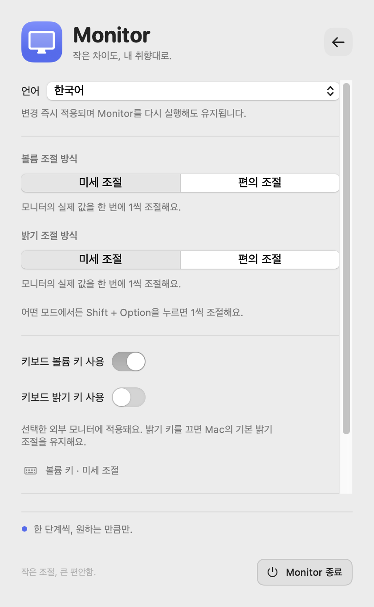

# Monitor

**딱 맞는 소리, 편안한 밝기.**

Pane와 같은 보라색 포인트와 둥근 카드 디자인을 사용하는 macOS 메뉴 막대 앱입니다.
외부 모니터의 스피커 볼륨과 밝기를 직접 제어합니다.
기본 볼륨 키 간격은 **실제 모니터 값 1**입니다. 20 → 21 → 22로 조절됩니다.


화면은 예시 값으로 렌더링한 미리보기입니다.

[English](README.md) · **한국어**

## Homebrew로 설치

Pane와 같이 이 공개 저장소를 전용 tap으로 사용합니다.

```bash
brew tap doumab180/monitor-control https://github.com/doumAb180/monitor-control
brew install --cask doumab180/monitor-control/monitor
```

업데이트할 때는 Monitor를 종료한 뒤 실행합니다:

```bash
brew update
brew upgrade --cask doumab180/monitor-control/monitor
```

Homebrew 공식 기본 저장소 등록이 아닌, 직접 관리하는 tap 배포입니다.

## DMG로 설치

1. [GitHub Releases](https://github.com/doumAb180/monitor-control/releases)에서
   `Monitor-0.2.1-arm64.dmg`를 내려받습니다.
2. DMG를 열고 **Monitor.app**을 **Applications** 폴더로 드래그합니다.
3. Monitor를 실행합니다. 상단 메뉴 막대의 모니터 아이콘을 클릭합니다.
4. 키보드 제어를 사용하려면 **시스템 설정 → 개인정보 보호 및 보안 → 손쉬운 사용**에서
   Monitor를 추가하고 허용합니다. 슬라이더 사용에는 이 권한이 필요하지 않습니다.
5. 기존 **MonitorControl을 종료**합니다. 동시에 실행하면 Monitor는 키보드 제어를 대기합니다.

현재 프리뷰 빌드는 ad-hoc 서명이며 Apple 공증은 되어 있지 않습니다.
다운로드한 앱의 실행이 차단되면 출처를 확인한 후 macOS의
**시스템 설정 → 개인정보 보호 및 보안 → 그래도 열기** 절차를 이용할 수 있습니다.
서명·공증된 일반 배포는 별도 Apple Developer ID가 필요합니다.

GitHub CLI로 파일만 내려받을 수도 있습니다:

```bash
gh release download v0.2.1 --repo doumAb180/monitor-control --pattern '*.dmg'
```

## 기능

- **볼륨 및 밝기 슬라이더**: 모니터의 실제 범위와 현재 숫자 표시
- **키보드 볼륨 키**: 기본 1씩 증가·감소
- **미세 조절**: 모니터의 실제 값을 1씩 조절 (기본값)
- **편의 조절**: 전체 범위를 16단계로 조절. 0~100이면 0 → 6 → 13 → 19 → 25처럼 이동
- **개별 설정**: 볼륨과 밝기의 조절 방식을 따로 선택
- **Shift + Option**: 편의 조절에서도 잠시 1씩 조절
- **밝기 키**: 별도로 켤 수 있음; 기본 꺼짐으로 Mac 자체 밝기 키 유지
- **음소거**: 0으로 내리고 앱 실행 중 기억한 이전 볼륨 복원; 이전 값이 없으면 1로 시작
- **여러 모니터**: 패널에서 선택한 모니터에 키보드 제어 적용
- **작은 화면 표시(HUD)**: 키보드로 바꾼 값 표시; 실제 적용 실패는 패널 상태에 표시
- **로그인 시 실행**: 설정에서 선택
- **자동 재연결**: 화면 구성 변경·잠자기 복귀 후 모니터나 활성화된 제어를 찾지 못하면 2·4·8·16초 후 재시도하며, 계속 실패하면 30초 간격으로 재시도
- **응답 확인**: 쓰기 후 실제 값을 다시 읽음. 일시적으로 확인에 실패해도 제어를 유지하고 자동 복구 상태를 표시합니다. 복구 시 실제 값을 읽으며 과거 명령을 재전송하지 않습니다.

## 지원 범위

- Apple Silicon Mac, macOS 13 이상
- DDC/CI 볼륨·밝기 읽기/쓰기를 지원하는 외부 모니터
- 영어·한국어·스페인어·중국어 간체·일본어·프랑스어·독일어 UI 지원
- Intel Mac, 내장 디스플레이, 소프트웨어 감마 조절, 시스템 오디오 볼륨 제어는 지원하지 않습니다.
- 모니터·케이블·도크에 따라 DDC가 전달되지 않을 수 있습니다. USB-C/DisplayPort 직접 연결을 권장합니다.
- 일부 HDMI 연결 및 DisplayLink/AirPlay/가상 모니터는 제어되지 않습니다.
- 모니터가 실제로 2 이상씩만 조절하거나 특정 값을 무시하면 1단위 동작을 강제할 수 없습니다.
- Apple Silicon의 비공개 IOAVService API를 사용하므로 macOS 변경에 따른 호환성 확인이 필요합니다.
- 다른 제어 앱에서 바꾼 값은 지속적으로 폴링하지 않습니다. **다시 검색**으로 현재 값을 동기화합니다.
- MonitorControl 충돌은 감지하지만 모든 타사 키보드 제어 앱을 자동 감지하지는 않습니다.

## 언어와 조절 방식



설정 아이콘을 누르면 언어와 볼륨·밝기 조절 방식을 바꿀 수 있습니다.
언어는 **시스템 설정 따르기** 또는 7개 언어 중 선택합니다. 지원되지 않는 시스템 언어는 영어로 표시합니다.
변경은 즉시 적용되고, 현재 안내 문구도 함께 바뀝니다. 재실행·업데이트 후에도 설정은 유지됩니다.
조절 방식은 볼륨과 밝기에 각각 저장됩니다. 슬라이더는 모드와 관계없이 1단위로 조절합니다.
편의 조절은 6을 고정으로 더하는 대신 다음 16단계 지점으로 이동하며 범위 끝에서 멈춥니다.

설정은 `io.github.doumAb180.Monitor` UserDefaults 영역에 저장됩니다.
언어를 바꿔도 선택한 모니터·키보드 설정·조절 방식은 유지됩니다.
`brew uninstall --zap`은 이 설정도 삭제합니다.

## 개발

Xcode 또는 Swift 5.9 이상을 제공하는 도구가 필요합니다. 외부 패키지 의존성은 없습니다.

```bash
git clone https://github.com/doumAb180/monitor-control.git
cd monitor-control
swift test
bash scripts/build.sh
```

결과:

```text
dist/Monitor.app
dist/Monitor-0.2.1-arm64.dmg
dist/Monitor-0.2.1-arm64.zip
dist/*.sha256
```

DDC 값 읽기 진단(모니터 설정 변경 없음):

```bash
dist/Monitor.app/Contents/MacOS/Monitor --probe
```

실물 볼륨 테스트(모니터 1대만 연결하고 다른 조절을 멈춘 상태에서 실행):

```bash
dist/Monitor.app/Contents/MacOS/Monitor --verify-volume-step
```

이 테스트는 읽은 볼륨을 **1 올린 뒤 즉시 원래 값으로 복원**하고 두 값의 응답을 검증합니다.
일반 실행·CI에서는 자동으로 실행하지 않습니다.

화면 목업 렌더링(예시 값 21/100 및 65/100, 하드웨어 접근 없음):

```bash
dist/Monitor.app/Contents/MacOS/Monitor --render-preview /tmp/monitor-preview.png
```

## GitHub 배포

`main`에 푸시하면 테스트 및 DMG 빌드가 실행되고 Actions 아티팩트로 저장됩니다.
`v0.2.1` 형태의 버전 태그를 푸시하면 테스트 후 **프리릴리스**에 DMG, ZIP, SHA-256을 업로드하고, `main`의 `Casks/monitor.rb`를 해당 DMG의 정확한 체크섬으로 갱신합니다.
배포 버전은 태그에서 추출되며 잘못된 버전 형식은 빌드가 거부합니다.

```bash
git tag v0.2.1
git push origin v0.2.1
```

## 구조

- `MonitorCore`: 실제 값 단위 조절, DDC 패킷 및 응답 검증, 쓰기 취소 토큰
- `DDCBridge`: Apple IOAVService 심벌을 동적으로 불러오는 작은 C 브리지
- `Monitor`: SwiftUI 패널, 메뉴 막대, 미디어 키 이벤트 처리, 직렬 하드웨어 통신

키 이벤트 콜백에서는 하드웨어 통신을 하지 않습니다. 슬라이더 변경을 모으고 오래된
대기 쓰기를 취소하며, 연결 세대 및 요청 번호로 이전 응답이 새 화면을 덮지 않도록 합니다.
앱은 키 입력을 저장하거나 전송하지 않으며, 외부 네트워크 요청 없이 동작합니다.

## 라이선스

MIT. MonitorControl 실행 파일에 의존하지 않는 별도 앱입니다.
DDC 프로토콜과 레지스트리 탐색은 공개 구현을 참고했습니다.
관련 출처 및 라이선스는 [THIRD_PARTY_NOTICES.md](THIRD_PARTY_NOTICES.md)에 포함되어 있습니다.
