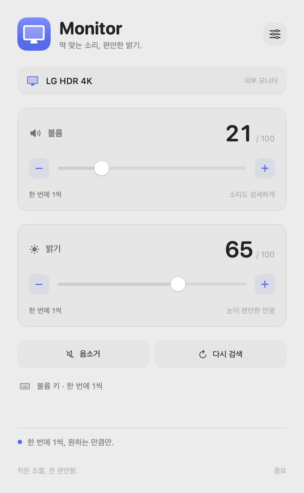

# Monitor

**Sound just right. Light just enough.**

**English** · [한국어](README.ko.md)

A small macOS menu bar app for external monitor volume and brightness, designed
to match [Pane](https://github.com/doumAb180/pane). Fine control changes the actual
monitor value by **one unit per press**: 20 → 21 → 22.



Preview rendered with sample values.

## Install with Homebrew

```bash
brew tap doumab180/monitor-control https://github.com/doumAb180/monitor-control
brew install --cask doumab180/monitor-control/monitor
```

This repository is a custom tap, like Pane. It is not part of Homebrew's default
cask repository. Quit Monitor before upgrading:

```bash
brew update
brew upgrade --cask doumab180/monitor-control/monitor
```

## Install from GitHub

Download `Monitor-0.2.1-arm64.dmg` from [Releases](https://github.com/doumAb180/monitor-control/releases),
open it, and drag **Monitor.app** into **Applications**. A ZIP and SHA-256 checksums
are also provided.

## First launch

1. Open Monitor and click its display icon in the menu bar.
2. For keyboard control, add and enable Monitor in **System Settings → Privacy & Security → Accessibility**.
   Sliders work without Accessibility permission.
3. Quit MonitorControl. Monitor waits before taking media keys while MonitorControl is running.

Preview builds are ad-hoc signed, not notarized with an Apple Developer ID.
macOS may require **System Settings → Privacy & Security → Open Anyway** after
you verify the source. Homebrew does not bypass this check.

## Adjustment modes

Choose the mode separately for volume and brightness in **Settings**:

| Mode | Behavior |
| --- | --- |
| Fine (default) | Exactly one hardware unit per press |
| Standard | 16 evenly spaced stops across the range, like macOS volume keys |

On a 0–100 monitor, Standard visits 0, 6, 13, 19, 25, …, 94, 100. It moves to
the next stop rather than always adding 6. Hold **Shift + Option** for a temporary
one-unit adjustment in either mode. Sliders always use individual hardware units.

- Keyboard volume control is on by default; brightness keys are opt-in.
- Keys affect the monitor selected in the panel.
- Mute sets volume to zero and restores the last nonzero value remembered during
  this session. If no prior value is known, unmute starts at 1.
- The HUD shows the requested value; the panel reports any readback mismatch.
- The app scans again after display changes and sleep/wake. Missing monitors or
  enabled controls are retried automatically after 2, 4, 8, 16, then every 30 seconds.
- Settings include launch at login.

## Language

Choose **Follow system**, English, 한국어, Español, 简体中文, 日本語, Français, or
Deutsch in **Settings → Language**. Changes apply immediately, including visible
feedback and the menu bar tooltip. Unsupported system languages fall back to
English. Chinese uses Simplified Chinese.

Language, adjustment modes, keyboard preferences, and selected display are saved
locally in the `io.github.doumAb180.Monitor` UserDefaults domain. They survive
restarts and normal updates. Changing language does not reset other preferences.
Uninstalling with Homebrew's `--zap` removes preferences.

## Compatibility

- Apple Silicon Macs, macOS 13 or later.
- External monitors that support DDC/CI reads and writes for volume/brightness.
- USB-C/DisplayPort direct connections are recommended. Some HDMI ports, docks,
  DisplayLink, AirPlay, and virtual displays do not expose DDC.
- Intel Macs, built-in display control, software dimming, and system audio
  volume control are not supported in this version.
- A monitor that ignores values or only accepts larger steps cannot be forced
  to support one-unit adjustments.
- Uses Apple's private IOAVService API; future macOS versions may require fixes.
- Hardware writes are verified by reading the resulting value. A failed readback
  keeps the control available and marks the value as unconfirmed while reconnecting
  automatically. Recovery reads the actual value and never replays old writes.
  Healthy controls remain usable during recovery; an absent monitor is removed
  when rediscovery confirms it is no longer available.
- Changes made by other apps are not polled continuously. Use **Scan again** to sync.
- MonitorControl is detected, but not every competing media-key app is detected.

## Build and verify

Requires Xcode or a Swift 5.9+ toolchain. No external package dependencies.

```bash
git clone https://github.com/doumAb180/monitor-control.git
cd monitor-control
swift test
bash scripts/build.sh
```

Outputs are in `dist/`: `Monitor.app`, an arm64 DMG, ZIP, and checksums.

```bash
# Read-only hardware diagnostic
dist/Monitor.app/Contents/MacOS/Monitor --probe

# Explicit hardware test: volume +1, read back, then restore the original value.
# Connect exactly one monitor and pause other volume adjustments first.
dist/Monitor.app/Contents/MacOS/Monitor --verify-volume-step

# Render sample UI without accessing hardware or changing saved settings.
dist/Monitor.app/Contents/MacOS/Monitor --render-preview /tmp/monitor.png --language en
dist/Monitor.app/Contents/MacOS/Monitor --render-preview /tmp/settings.png --settings --language ko --dark
```

See [verification notes](docs/VERIFICATION.md) for checks performed and manual checks remaining.

## Releases and Homebrew

GitHub Actions tests and builds pushes to `main` and pull requests. A `v0.2.1`-style
tag publishes a prerelease with the DMG, ZIP and checksums, then updates
`Casks/monitor.rb` on `main` using the SHA-256 of that exact published DMG.

```bash
git tag v0.2.1
git push origin v0.2.1
```

The cask restricts installation to Apple Silicon/macOS 13+, installs `Monitor.app`,
and only removes preferences when explicitly uninstalled with `--zap`.

## Architecture and license

`MonitorCore` contains hardware-unit stepping, DDC framing/validation and write
cancellation. `DDCBridge` resolves IOAVService dynamically. `Monitor` contains the
SwiftUI panel, localization, menu bar and media keys. Hardware I/O runs on a serial
queue; key callbacks never block on it. Superseded writes are cancelled, and stale
results are guarded by connection generation and request revision.

The app does not record or transmit keys and performs no network requests in normal use.

MIT. This is an independent application and does not require MonitorControl to be
installed. DDC protocol conventions and registry discovery reference its open
implementation. See [third-party notices](THIRD_PARTY_NOTICES.md).
